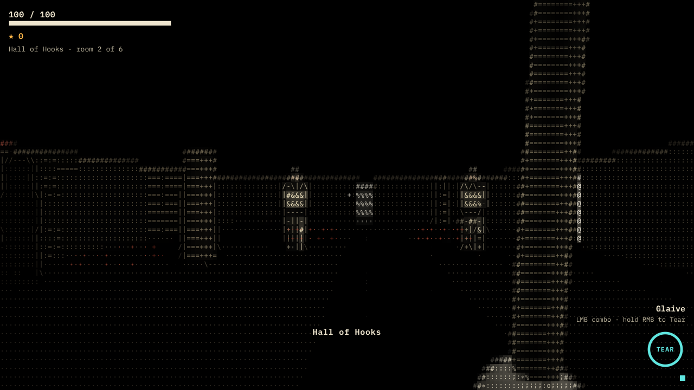
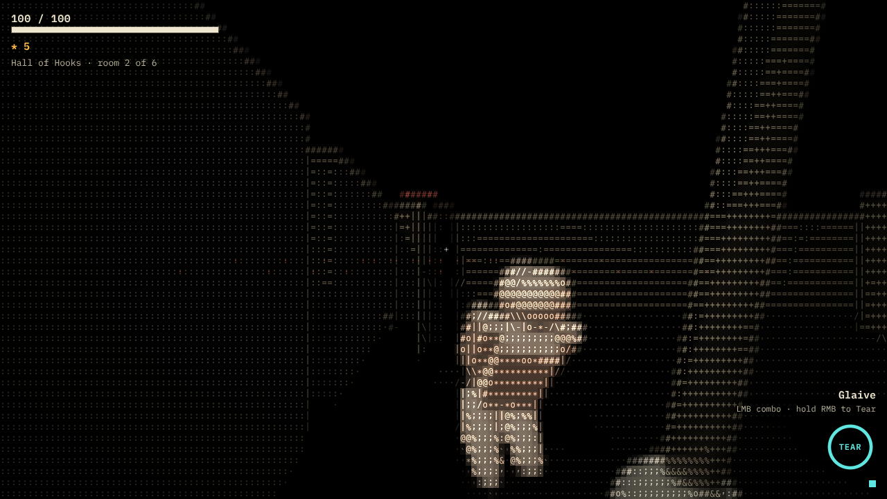
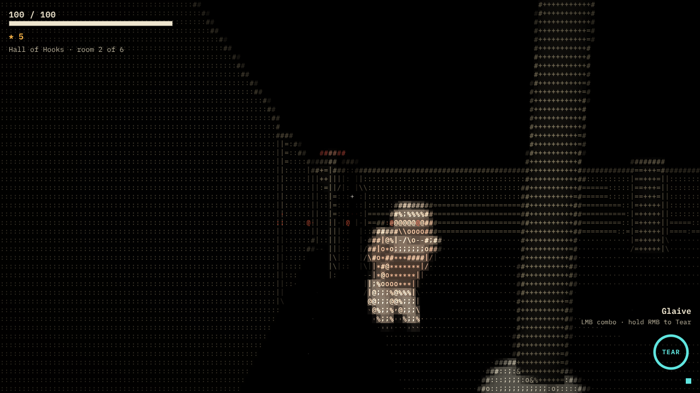

# VELLUM

A first-person 3D roguelite that is drawn entirely in ASCII. The world, the creatures, the weapons and the smoke all share one glyph language. A run takes roughly 10 to 15 minutes: explore a branching route, fight, pick upgrades, face The Scribe, then win or die and go again.



| Upgrade pick | The Scribe |
|---|---|
|  |  |

## Quick start

Requirements: Node.js 22 or newer and npm. Tested with Node 22.22 and npm 10.9, in headless Chromium with software WebGL2.

```bash
npm install
npm run dev          # http://127.0.0.1:5173
```

Build a static copy (relative asset paths, so it runs from any folder or static host):

```bash
npm run build        # outputs dist/
npm run preview      # optional: serve dist/ locally
```

## Controls

| Action | Keys and mouse |
|---|---|
| Move and strafe | W A S D |
| Look | Mouse (click the game to capture it; Esc releases) |
| Turn without the mouse | Left and right arrow keys |
| Attack | Left mouse. Glaive: click for the three-hit combo. Quill: hold to fire. |
| The Tear (signature) | Hold right mouse to charge, release to fire |
| Dodge | Space (invulnerable for a short window; the HUD pip glows) |
| Consult the altar | E, when standing by the cistern altar |
| Pause | P or Esc. Releasing the mouse also pauses. |
| Pick an upgrade | 1, 2, 3, or click |
| Menus | Arrow keys, Enter, or the mouse |
| Restart from an end screen | Enter or R |

## How a run works

The route has six stages: the nave, then three choice stages with two doors each, then the reliquary and The Scribe's arena.

- **Choice stages:** The Hall of Hooks or The Stacks; The Choir or The Cistern; The Ossuary or Lectern Gallery. Each door label shows the room's name and a short description once the room is clear.
- **Rewards:** Each cleared combat room offers three upgrades, with tradeoffs stated on each card. The Cistern's altar offers Mend (45% health) or Attune (one rare upgrade for 20 maximum health). The reliquary holds a gilded elite and gives a rare pick.
- **Win or lose:** Defeating The Scribe wins the run. Dying ends it. Both end screens show the run's stats and any unlocks, and offer an immediate restart.
- **Combos:** Five pairs of upgrades complete a combo: Pyre, Mirror Step, Starfall, Orbit Storm and Unshelled. The first time a pair is complete, a banner announces it and the codex records it.

### Weapons, the Tear and enemies

- **Glaive** (available from the start): a three-hit combo with buffered input. The third swing is heavy and staggers.
- **Glyph Quill** (unlocked by finishing a run): auto-fires bolts along the view with a small aim assist.
- **The Tear** (both weapons): charge for 0.9 s, then release a line of damage. Each hit strips one armour layer from an enemy. When the last layer is gone the core is exposed and takes extra damage. Fragments orbit you afterwards and fire at the nearest enemy.
- **Enemies:** Husk (a melee lunger), Acolyte (keeps its distance and fires seal bolts), Bulwark (slams and charges, with two armour layers), Gilded Bulwark (the elite, with three armour layers and a seal fan), and The Scribe. The Scribe has two phases. Below half health the book tears open, the seal plates fall away, and the attacks become faster and less predictable.

Every enemy attack has a visible telegraph, a sound cue and a windup of at least 0.5 s.

### Meta-progression

Progress is saved locally in the browser. Unlocks are shown on the loadout screen with the condition for each.

- Glyph Quill: finish a run.
- Starting boons: Ash Ward (clear the reliquary), Scribe's Pouch (visit a cistern), Dust Step (win).
- Modifiers: Ink Famine (win), Gilded Path (reach The Scribe).

## Design notes

- **Camera:** The original brief asked for an elevated three-quarter camera. You asked for first person instead, so the game uses a first-person camera at eye height with mouse look. The player's body is not drawn; a viewmodel shows the hands and the weapon.
- **Setting:** The Sunken Scriptorium, a flooded archive where written characters have taken flesh.
- **Palette:** Ivory is the world. Ember is danger (telegraphs, damage, burning). Amber is resources (shards, gilded plating). Cyan is abilities (the Tear, the Quill, dodge). Ash is fog and inactive things.

Design decisions are recorded in [`docs/superpowers/specs/2026-10-29-vellum-design.md`](docs/superpowers/specs/2026-10-29-vellum-design.md).

## Architecture

The stack is TypeScript, Vite and Three.js (WebGL2). Three.js supplies the scene, lights, shadows and geometry. Everything that makes the image look like text is custom: the glyph atlas, the render passes and the overlay. All UI text is DOM, so it stays crisp at any render scale.

### The ASCII pipeline

1. **Scene pass.** The 3D scene renders into a sample grid that has `sx` samples per cell horizontally and `2·sx` vertically. The samples are square on screen because cells are twice as tall as they are wide. Shadows use a 2048 map.
2. **Reduction pass.** One fragment per cell averages its samples into a brightness, a colour and a surface family. It reads depth to find silhouettes and edges, and reconstructs normals to tell floors from walls. It picks the glyph from a ramp (floors use dust, walls use hatching, other surfaces use the default ramp), or an edge glyph (`| / - \`, or `#` for strong silhouettes). Brightness is smoothed over time, and a deadband stops glyphs from flickering at ramp boundaries.
3. **Composite pass.** Per device pixel, it looks up the cell, draws the glyph from the atlas in the cell's colour, adds a faint neighbour glow, blends the CPU overlay on top, and applies radial distortion from powerful attacks.

The CPU overlay carries the effects: slash arcs, debris, telegraph shapes, collapse streams, spawn runes, pickups, ink hazards, projectiles, the Tear ring, the reticle, and the off-screen attacker markers. Fog is drawn as two world-anchored layers over the room's floor tiles.

### Code map

| Path | Responsibility |
|---|---|
| `src/render/` | Glyph atlas, GPU passes, shaders, overlay, palette |
| `src/world/` | Authored room templates, layout transforms and validation, route, tiles, room meshes |
| `src/sim/` | Fixed-step simulation: battle, player, weapons, Tear, enemies, boss, projectiles, grid |
| `src/game/` | Run director, upgrades and combos, meta-progression, world view |
| `src/fx/` | Effects and fog (events in, overlay glyphs out) |
| `src/model/` | Enemy rigs with grounded legs, the viewmodel, shared materials |
| `src/audio/` | Procedural WebAudio cues and ambience |
| `src/ui/` | DOM HUD, screens, styles |
| `src/app/` | Application state machine, input routing, fixed-step loop |
| `src/core/` | RNG, input, settings and save |
| `tests/` | Vitest unit suites |
| `e2e/` | Playwright scripts: flows, autopilot, performance, screenshots |

The simulation never touches rendering. Effects and the HUD only read events and state. Every room is generated from a seed, so runs are repeatable.

## Settings and accessibility

Glyph density, render quality, contrast, effects intensity, screen shake, hit-stop, reduced motion, mouse sensitivity and frame stats are all in the settings menu and saved locally. Reduced motion removes shake, camera kicks, distortion, head bob and hit-stop, and caps effects intensity at 50%. Audio has separate master, effects and ambience levels.

## Tests and checks

```bash
npm test             # Vitest unit suites (57 tests)
npm run typecheck    # strict TypeScript
npm run e2e          # Playwright flow checks against a running dev server (17 checks)
npm run autoplay     # god-mode autopilot through a full run to victory, seed 42
npm run perf         # frame timing presets (see docs/PERFORMANCE.md)
node e2e/gallery.mjs # regenerate docs/screenshots
```

The end-to-end scripts use the Chromium at `/opt/pw-browsers/chromium` by default. Set `CHROME_PATH` to use another browser. They expect the dev server on `127.0.0.1:5173`.

What the unit tests cover: every authored template generated from forty seeds, with all eight rotations and mirrors available to the generator (layouts valid, exits reachable, spawns fair); the battle rules (pursuit and damage, glaive kills and drops, dodge invulnerability, the Tear's armour and core rules, quill fire, boss phase change, room clear and exit, spawn fallback); upgrade derivation and combos; route and director flow; meta unlocks; and corrupt-save handling.

What the end-to-end checks cover: the title, settings and loadout menus with mouse clicks; the locked Quill; pausing and time freezing; combat loading; ending a run and restarting; the Quill unlock; and settings and progress surviving a reload. The autopilot covers the cistern altar, the reliquary and the boss fight in god mode. Run `node e2e/autoplay.mjs 7 0` for a mortal run that ends in defeat.

## Performance

Measured in headless Chromium with software WebGL2, since no GPU is available in this environment. At 1920×1080 the simulation and overlay cost about 2 ms of JavaScript per frame at every quality preset. The software-rendered frame rate is about 6 fps, which is dominated by software emulation and says nothing about GPU speed. The 60 FPS target on the stated baseline is **not verified**. See [`docs/PERFORMANCE.md`](docs/PERFORMANCE.md) for the method, the tables and how to measure on real hardware.

## Known limitations

- **Frame rate on real hardware is unverified.** The software GL numbers are a CPU emulation, not a GPU measurement.
- **Mouse look and pointer lock are not automated.** The end-to-end suite drives turning with the test hook and arrow keys. Pointer-lock capture and release should be checked by hand in a real browser.
- **Audio is synthesised and has not been listened to.** The tests check that the audio graph builds and that no errors occur; they do not check how it sounds.
- **Balance is unplaytested by people.** Difficulty was checked only through the god-mode autopilot and a few manual runs. Enemy counts, damage and the upgrade values may need tuning after playtests.
- **Fog and effects are overlay approximations.** The fog is sampled on floor tiles and drawn as glyphs. It is not a per-pixel volumetric pass.
- **Enemy movement is grid-based.** Enemies follow a walking field around pillars and separate from each other, but there is no navmesh and no dynamic avoidance beyond that.
- **Gamepad is not supported.**
- **The off-screen marker** shows only where attackers are, not a full threat radar.
- **Only one biome** and one set of enemy types are included; the boss has one fight.
- **Saves live in localStorage only.** Clearing site data resets progress and settings.
- **The bundle is about 0.7 MB minified,** mostly Three.js. The build's chunk-size warning is set aside for this slice.
- **Two shading shortcuts:** acolytes and the boss have no legs, so there is no foot placement for them. Enemy animation blends between poses, with no full skeletal retargeting.
- **Renderer fallback:** without float colour buffers the pipeline falls back to 8-bit targets, which quantises the brightness.

## Licence and fonts

The UI and glyph atlas use IBM Plex Mono, bundled through `@fontsource/ibm-plex-mono` under the SIL Open Font License.
